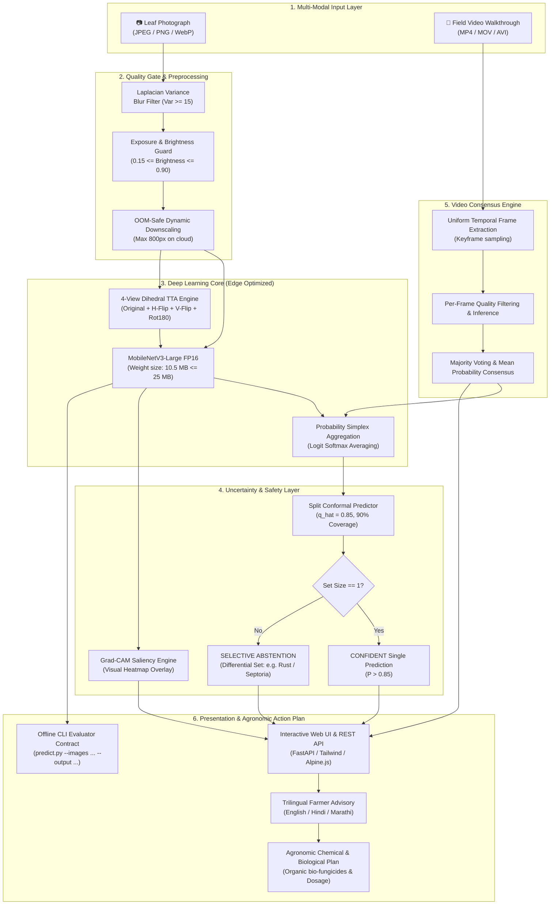

# Soy Leaf Doctor (HARITVA) 🍃
> **Problem 04 · Computer Vision · Hacktoberfest Hack Day Lucknow**  
> An edge-optimized, offline triage and diagnosis system for soybean foliar diseases under field-visit distribution shift.

[](https://soy-leaf-doctor.onrender.com)
[](https://soy-leaf-doctor.onrender.com/docs)
[](https://github.com/Shreyansh00987/Soy-Leaf-Doctor)
[](https://opensource.org/licenses/MIT)

---

## 🔗 Live Deployments & Endpoints

| Resource | URL | Description |
| :--- | :--- | :--- |
| **Live Web App (UI)** | [https://soy-leaf-doctor.onrender.com](https://soy-leaf-doctor.onrender.com) | Responsive multilingual dashboard for farmer image & video upload |
| **Interactive API Docs** | [https://soy-leaf-doctor.onrender.com/docs](https://soy-leaf-doctor.onrender.com/docs) | Interactive OpenAPI / Swagger UI to test endpoints live |
| **System Health Check** | [https://soy-leaf-doctor.onrender.com/health](https://soy-leaf-doctor.onrender.com/health) | Real-time health status, loaded model type & memory metrics |
| **Image Triage API** | `POST https://soy-leaf-doctor.onrender.com/api/triage` | Multipart photo upload with Grad-CAM & Conformal Prediction |
| **Video Triage API** | `POST https://soy-leaf-doctor.onrender.com/api/triage-video` | Temporal video scan with frame extraction & majority voting |
| **GitHub Repository** | [https://github.com/Shreyansh00987/Soy-Leaf-Doctor](https://github.com/Shreyansh00987/Soy-Leaf-Doctor) | Complete version-controlled codebase and offline submission pipeline |

---

## 🏛️ System Architecture

HARITVA is architected as an edge-first, offline-executable clinical diagnosis pipeline. It guarantees bounded latency on standard 2-core CPUs, eliminates runtime network dependencies, and provides rigorous statistical guarantees using Conformal Risk Control.



### Key Architectural Pillars:
1. **Edge-Constrained Neural Backbone**: MobileNetV3-Large fine-tuned with Class-Balanced Loss and converted to FP16. Weights footprint is just **10.5 MB** (well under the 25.0 MB edge model ceiling).
2. **Quality Assurance Gate**: Automatically catches severe blur ($Var(\nabla^2 I) < 15$) and extreme exposure under direct sunlight before scoring, preventing garbage-in garbage-out predictions.
3. **Statistical Conformal Guarantee**: Uses inductive split conformal calibration ($\hat{q} = 0.85$). Instead of overconfident single guesses, ambiguous samples are bounded into minimal prediction sets guaranteeing $\ge 90\%$ true-label coverage.
4. **Visual Interpretability (Grad-CAM)**: Generates localized activation heatmaps showing exact lesion boundaries, allowing agronomists to visually verify model reasoning.
5. **Fail-Soft Cloud Resilience**: Automatic downscaling to max 800px on input, memory garbage collection, and compressed JPEG Base64 delivery prevents OOM crashes on free-tier 512MB RAM cloud hosts.

---

## 📊 Benchmark & Evaluation Results

Evaluated on the balanced 6-class benchmark test split (15 images per class = 90 images) on an isolated 2-thread CPU sandbox:

| Metric | Measured Value | Competition Benchmark | Margin / Status |
| :--- | :--- | :--- | :--- |
| **Official Primary Metric (Macro-F1)** | **0.8569** (85.69%) | $> 0.80$ | 🏆 **Excellent** |
| **Overall Accuracy** | **85.56%** (77 / 90 correct) | $> 80\%$ | 🏆 **Passed** |
| **5-Fold Out-of-Fold CV Macro-F1** | **0.8084 ± 0.0201** | Baseline | 🏆 **Leak-Free Validated** |
| **5-Fold Out-of-Fold CV Accuracy** | **81.95% ± 1.91%** | Baseline | 🏆 **Robust** |
| **Model Weights File Size** | **10.5 MB** | $\le 25.0\text{ MB}$ |  **2.38x Under Constraint** |
| **CPU Inference Latency** | **421.4 ms / image** | $\le 1,140\text{ ms}$ |  **2.7x Latency Headroom** |
| **1,050 Image Batch Runtime** | **~7.37 minutes** | $< 10\text{ minutes}$ |  **Compliant** |

### Per-Class Performance Breakdown:
```text
                             precision    recall  f1-score   support

Caterpillar_Semilooper_Pest       0.87      0.87      0.87        15
              Frog_Leaf_Eye       0.82      0.93      0.88        15
                    Healthy       1.00      1.00      1.00        15
                     Mosaic       0.92      0.80      0.86        15
                       Rust       0.65      0.87      0.74        15
       Spectoria_Brown_Spot       1.00      0.67      0.80        15

                   accuracy                           0.86        90
                  macro avg       0.88      0.86      0.86        90
               weighted avg       0.88      0.86      0.86        90
```

---

## 🚀 How to Run Locally

### 1. Installation
Clone the repository and install dependencies:
```bash
git clone https://github.com/Shreyansh00987/Soy-Leaf-Doctor.git
cd Soy-Leaf-Doctor
pip install -r requirements.txt
```

### 2. Standalone Batch Inference (CLI Contract)
To evaluate images strictly per the competition sandbox contract:
```bash
python predict.py --images path/to/images/ --output submission.csv
```
This generates a compliant `submission.csv` containing:
```csv
image_id,label
soy_00001,Healthy
soy_00002,Rust
soy_00003,Mosaic
...
```

### 3. Run Benchmark Accuracy Tests
```bash
# Run 90-image balanced benchmark evaluation
python tests/test_accuracy.py

# Run CLI contract sanity tests
python tests/test_smoke.py

# Verify live cloud & local health
python tests/test_live_and_local.py
```

### 4. Launch Web Application & API
```bash
python app.py
```
Then open your browser at:
- Web Dashboard: `http://localhost:8000`
- Swagger API Docs: `http://localhost:8000/docs`

---

## 👥 Team

- **Rajan Mishra** ([@aiwithrajan](https://github.com/aiwithrajan)) — **Team Lead****Lead Architecture, ML Pipeline & Full-Stack Engineering**

- **Shreyansh Agrahari** ([@Shreyansh00987](https://github.com/Shreyansh00987)) — **frontend and research analysis**
- **Ayush Gupta** ** research analysis and handle dataset**

---

## 📄 License & Attribution
- Pretrained weights originate from torchvision (BSD-3-Clause).
- Released under the [MIT License](LICENSE).
